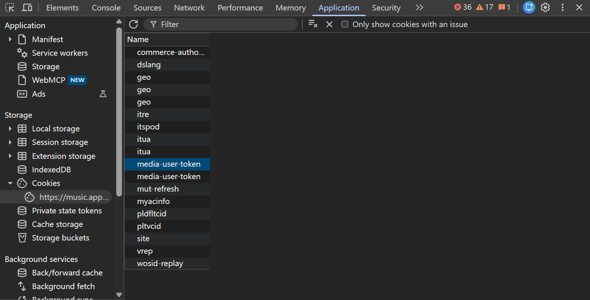

# Apple Music AAC Desktop

轻量的 Windows 中文桌面工具：输入一首 Apple Music 歌曲链接，保存 AAC 音频，按歌曲名称命名。

**这是源码发布。仓库不含任何人的登录、Cookie、加密凭据、音乐、下载缓存、运行环境、Apple 库或 Widevine 设备资料。** 不提供捆绑第三方运行库的“一键全家桶”。

## 功能

- 温和米色界面；下载在后台运行，可取消，已有文件不覆盖。
- 只接受单曲；带 `i=歌曲编号` 的专辑分享链接会转换成单曲，不展开整张专辑。
- 保存前检查 AAC 编码、曲目时长及完整解码；文件扩展名为 `.m4a`。
- 可更改保存文件夹；公开版默认使用当前 Windows 用户的“音乐/AppleMusic”。
- 登录指引和遮蔽粘贴框，不必手动制作 Cookie 文本。
- 可选 Windows DPAPI 当前用户加密记住登录，支持清除。
- 文件导入和用户触发的有限目录扫描作为备用方式，不自动提取浏览器凭据。

## 环境与首次安装

目前锁文件面向 **Windows x64、Python 3.13、.NET Framework 4.8 或更高版本**，其他架构/版本没有验证。

1. 从 Python 官方来源安装 64 位 Python 3.13，保留 pip。
2. 安装 FFmpeg，并确认 `ffmpeg` 和 `ffprobe` 在 PATH。可使用 Windows 官方 WinGet 索引中的 `Gyan.FFmpeg` 包；本项目不再分发 FFmpeg。
3. 下载本仓库源码，解压到你自己选择的稳定文件夹，例如 `C:\Apps\AppleMusicAAC`。不要把真实 Cookie 放进源码目录。
4. 先阅读 `THIRD_PARTY_NOTICES.md` 和 `SECURITY.md`。下载引擎涉及非官方认证和 DRM 组件，使用前需自行确认授权和服务条款。
5. 在该目录打开终端，执行：

   ```console
   python tools/setup.py --acknowledge-third-party-risk --shortcut
   ```

   该命令创建项目自己的 `.runtime`，按锁文件下载依赖，编译本项目 GUI，并创建桌面快捷方式。不会修改全局 Python、启动服务或更改系统安全设置。

安装会使用固定版本 `applemusic-dl 2.4.12`、`gamdl 3.8.5` 及列出的依赖。增强版从明确的 GitHub 发布地址安装，不使用 PyPI 上同名的原版包。`construct 2.8.8` 只有源代码包：它的哈希被锁定，构建会运行其打包脚本；安装确认参数包含这一风险。其余运行依赖要求使用锁定的 Windows wheel。

**验证范围：**现有 Windows 环境通过了源码编译和离线合成测试，但这套引导安装尚未经过独立的全新电脑安装验证。锁文件固定运行依赖的供应包哈希，不保证不同电脑生成逐字节相同的构建产物。构建工具固定版本但没有单独锁定其供应包哈希。源码构建、上游包可用性及设备资料的合法使用限制仍然适用；请先在你自己的干净环境验证。

如果 Python、FFmpeg、.NET Framework 编译器或兼容 wheel 缺失，安装会停止并显示本机错误；不要通过关闭安全保护解决问题。本工具仍依赖你安装的 Python 基础环境和 FFmpeg，不是可复制到任意电脑的独立运行时。

## 登录指引：不用编辑文本文件

1. 打开工具，点击“登录指引”。
2. 点击“打开 Apple Music”，在浏览器自行登录自己的订阅账号。
3. 按 `Ctrl + Shift + I`，打开 **Application（应用）**；标签隐藏时点 `»`。
4. 左侧展开 **Storage → Cookies**，选择 `https://music.apple.com`。
5. 找到名为 **`media-user-token`** 的行，只复制 **Value（值）**。
6. 返回工具，在隐藏输入框中手动粘贴，然后点击“保存登录”。不需要复制整行，不需要在浏览器控制台执行代码。
7. 请自行复制普通文字覆盖剪贴板。工具不会自动读取或清空你的整个剪贴板。

**不要把值、Cookie 文件、截图或原始错误日志发送到聊天、Issue、邮件或 GitHub。** 本教程的示例占位符 `YOUR_TOKEN_HERE` 不是可用凭据。

“下次保存时加密记住登录”只控制**下一次保存**。勾选时以 DPAPI 密文保存，仅供当前 Windows 用户、本工具向 Apple 认证使用。取消勾选时，新提供的值仅在当前窗口内使用，**不会删除以前保存的加密登录**；关闭窗口后以前的登录仍可能被使用。要移除已有登录，明确点击“清除登录”。登录失效时也应清除后重新提供；无需向维护者提供密码或验证码。DPAPI 不防范拥有同一 Windows 用户权限的恶意软件。

下载库需要临时明文 Cookie 文件。本工具把副本放在用户权限受限的任务目录，正常结束、取消时删除；异常关机的遗留任务会在下次启动清理。你自行选择的原始导入文件不会被删除。

## 扫描匹配（备用）

点击“扫描匹配…”后，自己选择保存 Cookie 文本的下载文件夹。所选目录必须归当前 Windows 用户所有，位于名为 `Download`、`Downloads` 或 `下载` 的目录中（也可直接选择该目录）。工具只检查所选目录当前层，以及本工具的 `import` 目录：

- 文件名为 `cookies*.txt` 或 `applemusic*.txt`，最多匹配检查 100 个候选；不进入子文件夹。
- 排除名称包含 `template`、`example`、`sample`、`模板` 的文件及链接文件。
- 不扫描磁盘根目录、AppData 本身及其子目录、已知浏览器/便携浏览器配置目录或系统凭据库；检测到浏览器配置标记文件也会拒绝扫描。
- 仅检查必需的 Cookie 结构，不显示或记录值。列表显示候选文件路径、修改时间，由你选择导入。
- 不在后台定时扫描。更推荐使用“登录指引”直接粘贴值。

## 下载与保存

1. 粘贴一首歌曲的 Apple Music 链接。
2. 如需更改位置，点击“更改…”，选择可写文件夹。该非敏感设置仅保存于本机。
3. 点击“下载单曲”，等待读取信息、下载和完整性检查。
4. 点击“打开文件夹”。文件名采用歌曲名称；非法文件名字符会替换，同名时添加歌手、歌曲编号或序号。

取消会停止后台进程树并清理本工具的临时凭据及未完成复制；已完成的音频会保留。下载结果不代表获得商用、再分发或其他使用授权。

## 开发、测试和发布

```console
python tools/setup.py --compile-only
.runtime\Scripts\python.exe -I tests/test_tool.py
AppleMusicAAC.exe --self-test
python tools/audit_release.py
```

测试只使用合成音频/虚构凭据，不执行真实 Apple 登录下载。GUI 自检生成自己的空白界面渲染图，不截图浏览器或用户桌面。发布请遵守 `RELEASE.md` 的精确白名单和隐私审查流程。不得把 `.runtime`、上游 wheel、设备资料、私有目录或本机设置放入源码包/Release。

## English overview

A source-only Windows desktop frontend for one-song AAC downloads using the pinned upstream engine. It includes explicit manual login guidance, masked token paste, optional Windows CurrentUser DPAPI storage, bounded user-triggered cookie-file matching, configurable output, safe naming/collision handling, cancellation and audio verification. No browser credential extraction, telemetry, third-party download broker, media or credential data is included. Fresh local authentication is required on each new computer. Read the third-party and security notices before installing dependencies.

## 屏幕缩放、进度与图示

窗口按当前屏幕工作区限制初始大小，内容区可滚动，底部下载、取消和进度区独立固定。启用 .NET Framework 4.8 的 PerMonitorV2；跨屏 DPI 改变后重新限制窗口范围，不修改 Windows 全局缩放。已进行 1366×768、1920×1080 下 100%、125%、150%、200% 的控件缩放与布局模拟；这不代表已完成真实多显示器、不同物理 DPI 的人工验证。

读取元数据、总长度未知时显示阶段与活动进度。传输阶段使用下载器实际字节或分片计数显示百分比；估算大小会标注“约”。传输结束仍需处理与音频验证，只有验证通过才显示完成和 100%。不按经过的时间伪造百分比。

登录指引内附下图，可点击放大。全部 Cookie 值已不可逆遮盖；按图找到自己浏览器中的位置，再私下复制自己的 `media-user-token` 值。



## 多首队列

输入框每行粘贴一个歌曲链接，点击“加入队列”检查并加入；也可以输入一首后直接点“开始下载”。队列默认串行，不同时启动多个下载进程。下载时可继续加入链接；保存位置和登录设置在当前队列运行时锁定。

队列显示待解析的规范链接，读取到歌曲名后替换为名称，同时显示等待、读取信息、下载中、处理中、校验中、完成、失败或已取消。只有音频验证完成的项目显示 100%。单项失败会继续下一项；缺少或无法读取登录资料时不发起下载，保留等待项，重新登录后可再次开始。临时凭据清理失败时暂停队列，先处理本地文件问题。

同一歌曲编号在列表中只保留一次，不区分链接中的国家地区或标题写法。无效链接跳过并显示数量，不请求其地址。列表最多 100 项、粘贴最多 65536 字符。若要重试失败项，点击“清除已结束项”后重新加入链接；这个按钮不移除当前项或等待项，也不删除音频。

“取消全部”停止当前下载并取消等待项，清理工具创建的临时 Cookie；已完成音频保留。关闭时若有当前或等待任务，会先询问是否取消退出；选择否保留队列。队列仅在当前窗口内存中保存，退出后不自动恢复或继续下载。仍只支持歌曲或带单首 i 参数的专辑链接，不展开专辑或播放列表。

## 离线队列维护测试

在已具备 .NET Framework 4.8 编译器的 PowerShell 中运行（源码根目录）：

```powershell
$csc = "$env:WINDIR\Microsoft.NET\Framework64\v4.0.30319\csc.exe"
$refs = @('/r:System.Windows.Forms.dll','/r:System.Drawing.dll','/r:System.Security.dll','/r:System.Web.dll','/r:System.Web.Extensions.dll')
& $csc /nologo /target:exe /codepage:65001 /main:QueueTests /out:tests/QueueTests.exe $refs AppleMusicTool.cs tests/QueueTests.cs
& .\tests\QueueTests.exe
& $csc /nologo /target:exe /codepage:65001 /win32manifest:app.manifest /out:tests/QueueUiTests.exe $refs tests/QueueUiTests.cs
Copy-Item App.config tests/QueueUiTests.exe.config
$state = Join-Path $env:TEMP ('AppleMusicQueueTests-' + [guid]::NewGuid().ToString('N'))
& .\tests\QueueUiTests.exe .\AppleMusicAAC.exe $state .\.runtime\Scripts\python.exe .\tests\queue_ui_mock.py
Get-Content (Join-Path $state 'queue-ui-results.json')
```

模型测试覆盖串行、失败继续、重复、取消及数量边界。界面测试只使用独立临时目录、虚构登录值和假任务，不导入 Apple 网络库，不产生真实下载；测试窗口的关闭确认也仅操作测试进程自己拥有的对话框。不得把 `$state` 改成应用目录或包含个人文件的目录；测试拒绝已有非空目录。假任务的“完成”仅用于验证界面调度，不代表音频验证测试，可与现有 Python 音频完整性测试配合运行。

## 页面滚轮

页面和登录指引使用应用内小步滚动。正常行滚动按系统设置的行数计算，每行 8 个逻辑像素；例如系统设为 3 行、150% 缩放时，一个刻度移动 36 像素。高精度滚轮按实际 delta 比例积累，不需要凑齐一个刻度后才跳动。系统设置为不滚动或整页滚动时分别遵守；不修改 Windows 的全局滚轮或缩放设置。

动画仅有一个当前目标，快速输入合并，反向输入取消旧方向，边界不积压额外位移。系统关闭客户端动画时直接应用小步位移；正常动画结束后计时器停止。滚动条拖动、焦点导航和窗口调整会终止旧动画。多行输入和队列有内容可滚时优先原生滚动；空白、内容较少或到该方向的边缘时，转交给外层平滑滚动，不重复消费，不改变输入内容、选择或焦点。

维护测试（接续上方 `$csc` 和 `$refs`）：

```powershell
& $csc /nologo /target:exe /codepage:65001 /main:ScrollTests /out:tests/ScrollTests.exe $refs AppleMusicTool.cs tests/ScrollTests.cs
& .\tests\ScrollTests.exe
& $csc /nologo /target:exe /codepage:65001 /win32manifest:app.manifest /out:tests/ScrollUiTests.exe $refs tests/ScrollUiTests.cs
Copy-Item App.config tests/ScrollUiTests.exe.config
$state = Join-Path $env:TEMP ('AppleMusicScrollTests-' + [guid]::NewGuid().ToString('N'))
& .\tests\ScrollUiTests.exe .\AppleMusicAAC.exe $state
Get-Content (Join-Path $state 'scroll-probe.json')
```

滚动界面测试只创建独立合成状态窗口，向它自己拥有的控件发送消息，记录位移、计时器、CPU 和原生重绘计数；不模拟全局鼠标，不读取真实登录，不调用 Apple。测试拒绝已有非空状态目录。跨 DPI 部分是对测试窗口发送 DPI 消息的模拟，真实屏幕 DPI 另行记录，不等同于真实多显示器验证。系统动画关闭和整页/零行偏好由纯模型测试与分支检查覆盖，不为测试更改系统设置。实际显示流畅程度仍需要用户设备体验确认。

API semantics: [MouseWheel event](https://learn.microsoft.com/en-us/dotnet/api/system.windows.forms.control.mousewheel), [system wheel preference](https://learn.microsoft.com/en-us/dotnet/api/system.windows.forms.systeminformation.mousewheelscrolllines), [read-only client animation query](https://learn.microsoft.com/en-us/windows/win32/api/winuser/nf-winuser-systemparametersinfow). The smaller logical line size and target interpolation are application choices.

## 输入区与队列的滚动链

鼠标停在空输入或空队列上时也能滚动页面。长内容在当前方向还有空间时先在控件内部滚动；到边缘后再交给页面。多刻度消息只把未被内部消费的部分交给外层一次。内层可滚时先累积普通高精度 delta，再交给原生控件完整刻度，避免隐藏缓存；交给外层的部分继续按比例平滑滚动；到边缘时交接剩余部分。反向、修改内容、改变视口或切换滚动归属会取消旧的未执行意图，避免回头时卡住或突然补滚。

Ctrl、Shift、Alt 或鼠标按键修饰的消息保持原生控件处理，不强行转为页面竖向滚动。只对应用自己的普通链接输入和队列安装控件内消息处理，不使用全局鼠标钩子，不接管登录密码框、浏览器或其他窗口。

维护测试（同上 `$csc`、`$refs`）：

```powershell
& $csc /nologo /target:exe /codepage:65001 /main:WheelChainModelTests /out:tests/WheelChainModelTests.exe $refs AppleMusicTool.cs tests/WheelChainModelTests.cs
& .\tests\WheelChainModelTests.exe
& $csc /nologo /target:exe /codepage:65001 /win32manifest:app.manifest /out:tests/WheelChainUiTests.exe $refs tests/WheelChainUiTests.cs
Copy-Item App.config tests/WheelChainUiTests.exe.config
$state = Join-Path $env:TEMP ('AppleMusicWheelChainTests-' + [guid]::NewGuid().ToString('N'))
& .\tests\WheelChainUiTests.exe .\AppleMusicAAC.exe $state
Get-Content (Join-Path $state 'wheel-chain-results.json')
```

界面测试使用独立合成内容和自己的窗口消息，覆盖空/短/长输入、两端、正反向、小 delta、队列、选择与焦点、修饰键消息位、控件句柄重建和页面边界；数字断言基于系统设置为每刻度 3 行，其他设置会报告失败，不为测试改动系统。修饰键是消息标志测试，不向全局键盘注入按键。真实硬件手感仍需体验确认。

## 专辑归档与整理已有歌曲

新下载使用本次歌曲响应里已有的 `albumName`，保存为“所选输出根目录 / 专辑名 / 曲名.m4a”，不额外查询专辑、不扩大下载范围。同名专辑归在一起；缺失专辑名归“未知专辑”。非法字符、设备保留名和超长专辑名会安全缩短，必要时附稳定摘要，避免不同名称被清理成同一路径。歌曲同名继续采用不覆盖的备用文件名。

整理已有文件：

1. 用“更改保存位置”选择**音乐总目录**，不要选择磁盘根目录、应用或源码目录。
2. 点击“整理已有歌曲”。先只扫描本地内嵌专辑标签，显示原位置、目标位置、保留/跳过原因。
3. 核对预览后，明确点击“确认整理”才移动。点击取消、按 Esc 或关闭预览均不会批准移动；计划等待超过 15 分钟失效。
4. 整理期间显示处理/移动/失败数量，下载和其他整理操作互斥。取消会等待当前文件安全结束；已确认后可能保留已经完成的移动。整理中关闭主窗会先请求停止，结束后可再次关闭。
5. 结果显示计数及本地移动记录位置。再次整理已经位于正确专辑目录的歌曲不会重复套文件夹。已有歌曲保留原文件名，不根据文件名猜专辑，也不改写音频或标签。

支持 `.m4a .mp3 .flac .wav .ogg .opus .aif .aiff .aac .wma`，还会用既有 FFprobe 验证是音频；扩展名相同的非音频不会移动。缺少标签统一归“未知专辑”，不发起网络查询。元数据读取限制为本地文件协议及音频容器白名单。

同名目标不覆盖，预览会分配数字后缀；确认后若源文件发生变化或目标被占用，则保留源文件并记录失败。使用 Windows 原子重命名；跨卷或文件占用失败时不会偷偷执行复制后删除。扫描不跟随符号链接、junction、其他重解析点或云占位文件；不移动硬链接，跳过点号开头目录/文件及识别出的应用/源码子目录。范围限制为 8 层、5000 个候选音频、2000 个目录、每文件 2 GiB；每次元数据读取最多 15 秒。只支持本地目录，拒绝 UNC、设备路径、磁盘根目录和过深的根路径（超过 180 个 UTF-16 单位）；目标完整路径保守限制在 240 单位。超限会停止或跳过并报告，不修改系统长路径策略。

### 移动记录与恢复

记录位于音乐总目录的 `.applemusic-organizer/*.jsonl`，记录相对于该总目录的 `source`、`target`、文件身份/内容摘要、`intent`（移动前已刷新）、`moved`（成功）或 `failed`。这些是**私人曲目清单，不要上传到聊天、Issue、GitHub 或开源包**。临时预览保存在应用自己的 `private/organize-jobs`，仅清理已知计划文件；遇到意外文件则保留并提示。

需要恢复时先停止下载/整理，保留记录副本。按成功的 `moved` 对应 `intent` 逐项检查：目标文件仍存在、原路径空闲、内容 SHA256 与记录一致，再手动移回原相对路径；原路径已有文件时不要覆盖。中断可能只有 `intent` 而没有 `moved`，此时先检查两边实际位置，不要据记录盲目移动。没有自动回滚按钮；记录失败或部分完成时保留已移动音乐，人工核对记录后处理。不要删除唯一一份音频。

### 专辑功能的离线测试

```powershell
.runtime\Scripts\python.exe -I -B tests/test_album_library.py
.runtime\Scripts\python.exe -I -B tests/test_tool.py
& $csc /nologo /target:exe /codepage:65001 /win32manifest:app.manifest /out:tests/OrganizerUiTests.exe $refs tests/OrganizerUiTests.cs
Copy-Item App.config tests/OrganizerUiTests.exe.config
$fixtures = Join-Path $env:TEMP ('AppleMusicAlbumUi-' + [guid]::NewGuid().ToString('N'))
.runtime\Scripts\python.exe -I -B tests/prepare_organizer_ui.py $fixtures
& .\tests\OrganizerUiTests.exe .\AppleMusicAAC.exe $fixtures
Get-Content (Join-Path $fixtures 'organizer-ui-results.json')
```

只使用新建、带标记的合成音频目录。界面测试验证取消和关闭预览零移动、明确确认后移动、所有音频字节保持及互斥，不读取真实账号，不自动整理现有音乐。当前测试环境不能创建真实 junction，因此该用例跳过，另有属性模拟拒绝测试；跨卷失败由注入 `EXDEV` 覆盖，不代表真实跨卷测试。文件占用使用了 Windows 实际共享模式。共享目录锁协调本工具的进程，不能约束不遵守锁的其他程序；执行前会再核对路径、重解析点和文件指纹，不承诺抵御同用户恶意持续替换文件。归档不代替备份。

专辑字段来源：[Apple Songs.Attributes](https://developer.apple.com/documentation/applemusicapi/songs/attributes-data.dictionary)。
